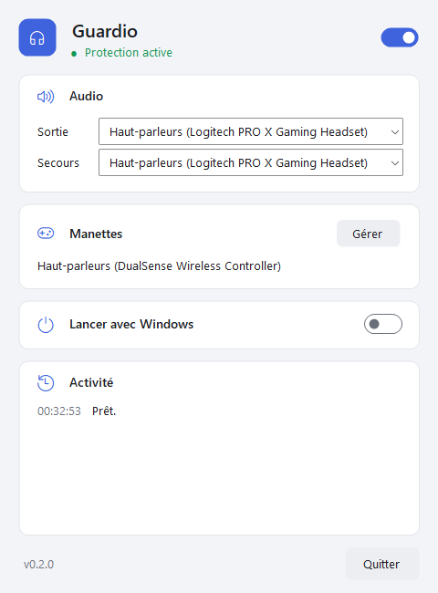

# Guardio

**Keeps your headset selected when you plug in a game controller.**

[](https://github.com/Nagaraaa/Guardio/actions/workflows/build.yml)
[](LICENSE)

When you connect a DualSense, DualShock 4 or Xbox controller over USB, Windows often switches its sound output to the controller. Guardio notices the switch and puts your previous output back. The controller's audio device stays enabled.

Portable Windows x64 app. The interface is in French. [Guide en français](docs/README.fr.md)

<p align="center">
  <picture>
    <source media="(prefers-color-scheme: dark)" srcset="docs/images/guardio-dark.png">
    
  </picture>
</p>

## Download

**[Guardio v0.2.0 — standalone ZIP](https://github.com/Nagaraaa/Guardio/releases/download/v0.2.0/Guardio-v0.2.0-windows-x64.zip)** (recommended, includes .NET)

Also available: a [smaller ZIP](https://github.com/Nagaraaa/Guardio/releases/download/v0.2.0/Guardio-v0.2.0-windows-x64-framework-dependent.zip) that needs the [.NET 8 Desktop Runtime x64](https://dotnet.microsoft.com/download/dotnet/8.0), checksums and older versions on the [releases page](https://github.com/Nagaraaa/Guardio/releases).

New in 0.2.0: redesigned interface with light and dark themes, support for DualShock 4 and Xbox controllers, and manual controller selection.

Extract it anywhere and run `Guardio.exe`. No installer and no admin rights. To uninstall, turn off **Lancer avec Windows**, quit, and delete the folder.

Coming from GardeAudio? Quit it, then copy its `donnees/` folder next to `Guardio.exe` to keep your settings.

## Usage

- The switch at the top turns protection on or off.
- **Sortie**: the current Windows output. Choosing one here always wins, even the controller.
- **Secours**: used if the previous output is gone.
- **Manettes → Gérer**: choose which outputs count as controllers, if yours isn't detected automatically.
- **Lancer avec Windows** starts Guardio hidden in the notification area when you log in.
- Closing the window keeps Guardio running in the notification area. **Quitter** (or right-click the tray icon) stops it.

## How it works

When a controller's audio output appears, Guardio watches the Windows default output for two seconds. If it moves to the controller, Guardio restores the previous output, at most once per audio role (console, multimedia, communications). Outside that window, your choices are never overridden.

Controllers are recognized by name (DualSense, DualSense Edge, DualShock 4, Xbox controllers, "Gamepad"). Any other output can be marked manually.

Guardio does not disable devices, install drivers, change microphones or volume, or use the network. Its only system change is the optional startup entry in `HKCU\…\Run`. Settings and a log are stored in `donnees/` next to the executable.

**Known limits:** a manual switch to the controller in Windows settings within those two seconds is also undone; use **Sortie** in Guardio instead. A brief sound cut can happen. Apps that target the controller directly are not rerouted. The output switch uses Windows' undocumented `PolicyConfig` interface.

## Build

Requires Windows and the [.NET 8 SDK](https://dotnet.microsoft.com/download/dotnet/8.0).

```powershell
dotnet build src/Guardio/Guardio.csproj -c Release
dotnet run --project tests/Guardio.Tests/Guardio.Tests.csproj -c Release
./scripts/Publish.ps1
```

`Publish.ps1` writes both ZIPs and `SHA256SUMS.txt` to `artifacts/`.

## Bug reports

`Guardio.exe --inventory inventory.json` writes your audio devices and defaults to a file (read-only). Remove device IDs before sharing it in an [issue](https://github.com/Nagaraaa/Guardio/issues).

`--live-test <folder>` is a developer check that **changes real audio defaults** (then restores them). It needs a headset selected in Windows and a connected controller.

## License

[MIT](LICENSE)
